

<a href="https://hannn.my.id">
  <picture>
    <source media="(prefers-color-scheme: dark)" srcset="assets/hero-dark.svg" />
    <source media="(prefers-color-scheme: light)" srcset="assets/hero-light.svg" />
    
  </picture>
</a>

  

<a href="https://hannn.my.id"><picture><source media="(prefers-color-scheme: dark)" srcset="assets/btn-portfolio-dark.svg" /><source media="(prefers-color-scheme: light)" srcset="assets/btn-portfolio-light.svg" /></picture></a>&nbsp;<a href="https://handigital.biz.id"><picture><source media="(prefers-color-scheme: dark)" srcset="assets/btn-agency-dark.svg" /><source media="(prefers-color-scheme: light)" srcset="assets/btn-agency-light.svg" /></picture></a>&nbsp;<a href="https://www.linkedin.com/in/muhammad-farhan-79ba79294/"><picture><source media="(prefers-color-scheme: dark)" srcset="assets/btn-linkedin-dark.svg" /><source media="(prefers-color-scheme: light)" srcset="assets/btn-linkedin-light.svg" /></picture></a>&nbsp;<a href="https://wa.me/6285121170403"><picture><source media="(prefers-color-scheme: dark)" srcset="assets/btn-whatsapp-dark.svg" /><source media="(prefers-color-scheme: light)" srcset="assets/btn-whatsapp-light.svg" /></picture></a>&nbsp;<a href="mailto:hi.mhdfarhan@gmail.com"><picture><source media="(prefers-color-scheme: dark)" srcset="assets/btn-email-dark.svg" /><source media="(prefers-color-scheme: light)" srcset="assets/btn-email-light.svg" /></picture></a>

 

### `01.` About

Informatics Engineering undergraduate at **Universitas Muhammadiyah Riau** (`3.92 / 4.0` GPA) and freelance fullstack developer with over <!--years-->4<!--/years--> years of experience building web apps, enterprise information systems, and SaaS products. Founder of **[HanDigital](https://handigital.biz.id)** — helping businesses and organizations ship production-grade digital software. Full background and credentials are on **[hannn.my.id](https://hannn.my.id)**.

<b>HanDigital Services</b> &nbsp;·&nbsp; click to expand

 

| Service | Scope |
| :-- | :-- |
| **Web Application & SaaS** | Custom dashboards, SaaS MVPs, RBAC auth, Midtrans payment gateway (QRIS & Virtual Accounts) |
| **Information Systems & ERP** | Multi-branch inventory, retail POS, digital accounting, workflow & admin automation |
| **Company Profile & Landing Page** | Modern editorial architecture, fast load times, Core Web Vitals & SEO/GEO optimization |
| **UI/UX Product Design** | User flows, wireframes, Figma design systems & pixel-accurate frontend engineering |

### `02.` Tech Stack

  <picture>
    <source media="(prefers-color-scheme: dark)" srcset="assets/marquee-1-dark.svg" />
    <source media="(prefers-color-scheme: light)" srcset="assets/marquee-1-light.svg" />
    
  </picture>
  <picture>
    <source media="(prefers-color-scheme: dark)" srcset="assets/marquee-2-dark.svg" />
    <source media="(prefers-color-scheme: light)" srcset="assets/marquee-2-light.svg" />
    
  </picture>

 

**Tools & Infra:** Figma · Git · GitHub · Postman · Docker · Vercel · Cloudinary

### `03.` Selected Works

<a href="https://hannn.my.id/portfolio"><picture><source media="(prefers-color-scheme: dark)" srcset="assets/project-escaluc-dark.svg" /><source media="(prefers-color-scheme: light)" srcset="assets/project-escaluc-light.svg" /></picture></a>&nbsp;<a href="https://hannn.my.id/portfolio"><picture><source media="(prefers-color-scheme: dark)" srcset="assets/project-kknflow-dark.svg" /><source media="(prefers-color-scheme: light)" srcset="assets/project-kknflow-light.svg" /></picture></a>

<a href="https://hannn.my.id/portfolio"><picture><source media="(prefers-color-scheme: dark)" srcset="assets/project-bka-dark.svg" /><source media="(prefers-color-scheme: light)" srcset="assets/project-bka-light.svg" /></picture></a>&nbsp;<a href="https://hannn.my.id/portfolio"><picture><source media="(prefers-color-scheme: dark)" srcset="assets/project-sala-dark.svg" /><source media="(prefers-color-scheme: light)" srcset="assets/project-sala-light.svg" /></picture></a>

  

**[Explore the full project archive at hannn.my.id/portfolio &rarr;](https://hannn.my.id/portfolio)**

### `04.` GitHub Activity

  <picture>
    <source media="(prefers-color-scheme: dark)" srcset="assets/activity-dark.svg" />
    <source media="(prefers-color-scheme: light)" srcset="assets/activity-light.svg" />
    
  </picture>
    
  <picture>
    <source media="(prefers-color-scheme: dark)" srcset="assets/heatmap-dark.svg" />
    <source media="(prefers-color-scheme: light)" srcset="assets/heatmap-light.svg" />
    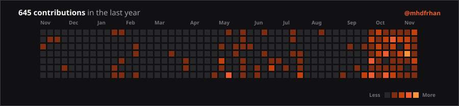
  </picture>
    
  <picture>
    <source media="(prefers-color-scheme: dark)" srcset="assets/stats-dark.svg" />
    <source media="(prefers-color-scheme: light)" srcset="assets/stats-light.svg" />
    
  </picture>

Have a web app, SaaS, or system in mind? **[Free consultation via WhatsApp](https://wa.me/6285121170403)** · **[handigital.biz.id](https://handigital.biz.id)**

