

 

## Tentang

Mahasiswa Teknik Informatika dan freelance fullstack developer dengan pengalaman lebih dari <!--years-->4<!--/years--> tahun membangun website dan sistem aplikasi. Saya juga menjalankan **[HanDigital](https://handigital.biz.id)**, agensi yang mengerjakan web application & SaaS, sistem informasi & ERP, company profile, dan desain UI/UX. Konsultasi awal gratis.

<b>Layanan HanDigital</b> &nbsp;·&nbsp; klik untuk membuka

 

| Layanan | Cakupan |
| :-- | :-- |
| **Web App & SaaS** | Dashboard, MVP SaaS, payment gateway (Midtrans), RBAC |
| **Sistem Informasi & ERP** | Inventaris, POS, keuangan, administrasi, tracking progres |
| **Company Profile & Landing Page** | Cepat, responsif, ramah SEO |
| **UI/UX Design** | Riset, wireframe, prototype Figma, implementasi frontend |

## Tech Stack

  
  

 

**Tools:** Figma · Git · GitHub · Canva · Postman · Vercel

## Proyek Pilihan

| Proyek | Deskripsi | Stack |
| :-- | :-- | :-- |
| **Escaluc OS** | ERP & omnichannel POS untuk retail gadget | Laravel, Vue, Inertia, Electron |
| **KKNFlow** | Platform manajemen tim KKN | Laravel, Inertia, Midtrans, PWA |
| **Portal BKA UMRI** | Sistem layanan keuangan Universitas Muhammadiyah Riau | React, TypeScript, Laravel |
| **Sala Coffee** | Sistem bisnis kedai kopi dengan pembayaran online | Laravel 12, Livewire 3, Midtrans |
| **BankID API** | Direktori data bank Indonesia | JavaScript, Node.js |
| **Catetin** | Aplikasi to-do list berbasis AI | Flutter, Firebase |

**[Lihat semua proyek di hannn.my.id/portfolio &rarr;](https://hannn.my.id/portfolio)**

## Aktivitas GitHub

  
    
  

Punya ide sistem atau website? **[Ngobrol di WhatsApp](https://wa.me/6285121170403)** atau kunjungi **[handigital.biz.id](https://handigital.biz.id)**.

